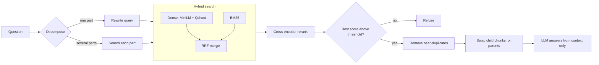

# Document Q&A: Hybrid Retrieval, Reranking and Grounded Answers

A retrieval-augmented generation (RAG) system that answers questions about PDF reports, cites the file and page for every answer, and refuses when the evidence is weak. It works on scanned PDFs through OCR. The pipeline is tested, evaluated against held-out questions, and served through a Streamlit app.

**Live demo:** _add the Streamlit link here after deployment_

## Results at a glance

Tested on one document: the WTTC *Introduction to AI* report (44 scanned pages, OCR with Tesseract 5.5.3, 618 searchable chunks). 20 answerable questions (10 used while building, 10 held out) and 5 unanswerable ones.

| Measure | Result |
|---|---|
| Correct chunk in top 5 after reranking (strict gold rule) | **91%** |
| Held-out questions answered with all facts correct | **9 of 10** |
| Answerable questions wrongly refused | **0 of 20** |
| Unanswerable questions refused by the LLM alone | **4 of 5** |
| Median answer time | **12 s** (p95 22 s) |

Held-out questions scored about the same as the ones used during development, so there is no sign of overfitting to the tuning set. **This is one document and 25 questions. It does not show the system works on other PDFs.** See [Test it on your own PDF](#test-it-on-your-own-pdf).

## What it does

- Reads PDFs, using each page's text layer and falling back to OCR for scanned pages
- Splits text into small **child chunks** (what gets searched) and larger **parent chunks** (what the LLM reads)
- Searches two ways: dense vectors (MiniLM + Qdrant) for meaning and BM25 for exact words, merged with Reciprocal Rank Fusion
- Reranks the top 20 candidates with a cross-encoder
- Splits multi-part questions and searches each part separately
- Removes near-duplicate passages
- Answers only from the retrieved text, with source file and page
- Refuses when the best reranker score is below a threshold

## Architecture



## Tech stack

Python 3.10+, PyMuPDF and Tesseract (reading and OCR), sentence-transformers (`all-MiniLM-L6-v2`, `ms-marco-MiniLM-L-6-v2`), Qdrant, rank-bm25, LangChain, Groq (`openai/gpt-oss-120b`), Streamlit, pytest.

## Project structure

```
src/
  config.py            all settings and secret loading
  loader.py            PDF -> pages, OCR fallback
  ingestion.py         pages -> parent and child chunks
  embeddings.py        embedding model, loaded once
  retrieval.py         Qdrant + BM25 + RRF, document filtering
  reranking.py         cross-encoder
  llm.py               Groq client with timeout and retries
  query_processing.py  decompose and rewrite prompts
  generation.py        answer prompts
  pipeline.py          the full flow: rag_pipeline, build_index
evaluation/
  eval_dataset.py      the original 10 questions
  eval_heldout.py      10 held-out + 5 unanswerable questions
  evaluation.py        end-to-end metrics and CSV reports
  ablation.py          dense vs BM25 vs hybrid vs rerank, refusal threshold
  common.py            gold chunks, metrics, index loading
tests/                 unit tests that need no model downloads
app.py                 Streamlit interface
```

## Quick start

You need Python 3.10+, a [Groq API key](https://console.groq.com), and Tesseract OCR.

```bash
git clone <your-repo-url> && cd <repo>
python -m venv .venv
source .venv/bin/activate            # Windows: .venv\Scripts\activate
pip install -r requirements.txt
cp .env.example .env                 # then edit .env and add your key
streamlit run app.py
```

**Install Tesseract**
- macOS: `brew install tesseract`
- Ubuntu: `sudo apt install tesseract-ocr`
- Windows: install the UB Mannheim build, add `C:\Program Files\Tesseract-OCR` to your PATH, open a **new** terminal, and check with `tesseract --version`

Put the sample PDF at `data/2024-wttc-introduction-to-ai.pdf` to enable the "Use the sample report" button. Check the report's licence before committing it to a public repository. Otherwise upload any PDF in the app's sidebar.

## Managing API keys

| Where | How |
|---|---|
| Local development | Put `GROQ_API_KEY=...` in `.env`. The file is git-ignored. Never rename it to something that is not ignored. |
| Streamlit Cloud | App settings -> Secrets -> `GROQ_API_KEY = "..."` |
| GitHub Actions (if you add CI later) | Repository settings -> Secrets and variables -> Actions |
| Any other host | Use the host's environment-variable settings. Never put keys in code, notebooks, logs, screenshots or chat messages. |

Good habits:
- Create a separate key for each environment, so one leak does not cost you everything.
- Set a spending or rate limit on the key in the provider's console.
- **Rotate a key immediately** if it ever appears in a notebook, a commit, a log or a screenshot. Deleting the file afterwards does not help, because git keeps history.
- Run a secret scanner before pushing, for example `pip install detect-secrets` or the `gitleaks` GitHub Action.
- The app reads keys only through `get_secret()` in `src/config.py` and raises a clear error if one is missing.

## Usage

**App:** upload PDFs or use the sample, ask a question, open "Sources" to see the file, page and reranker score. The sidebar sets how many candidates to rerank and how many passages the LLM sees, and has a "Show retrieval details" switch.

**Python:**

```python
from src.pipeline import build_index, rag_pipeline

index = build_index(["data/report.pdf"], force_ocr=True)   # OCR every page; use False for text PDFs
result = rag_pipeline("How fast did ChatGPT reach 100 million users?", index)
print(result["answer"])
```

## Evaluation

```bash
python -m evaluation.evaluation --heldout    # full pipeline on all 25 questions
python -m evaluation.ablation                # which pipeline stage helps, and the refusal threshold
python -m pytest                             # 22 unit tests
```

Use `--pdf PATH` if the PDF is not in `data/`. Reports are written to `evaluation/results/`.

### How I measure

- **Gold chunks:** a chunk is "relevant" if it contains the answer keywords. The *original rule* counts a chunk if it has any keyword; the *strict rule* needs at least two in the same chunk. The original rule is too loose for broad words like "data", so I report both and trust the strict one.
- **Fact coverage:** the share of required facts that appear in the answer text. It uses string matching, so a correct answer worded differently counts as a miss.
- **Refusals:** the answer is checked for phrases like "not available in the provided context".

### Results in full

**Full pipeline, 20 answerable questions**

| Metric | Strict gold | Original gold |
|---|---|---|
| Candidate recall@10 | 0.911 | 0.816 |
| Reranked recall@5 | 0.911 | 0.769 |
| Reranked MRR | 0.860 | 0.909 |
| Mean fact coverage | 0.850 (0.867 with number words normalised) | |
| Median / p95 latency | 12.2 s / 22.3 s | |

**Ablation: which stage helps (retrieval only, no LLM)**

| Method | Recall@5 | MRR | Strict recall@5 | Strict MRR |
|---|---|---|---|---|
| Dense only | 0.638 | 0.804 | 0.806 | 0.800 |
| BM25 only | 0.614 | 0.792 | 0.748 | 0.759 |
| Hybrid (RRF) | 0.638 | 0.882 | 0.783 | 0.857 |
| Hybrid + rerank | 0.722 | 0.864 | 0.850 | 0.838 |

Reranking raises recall@5, while plain RRF has a slightly higher MRR. With 20 questions the differences are small, so I do not claim one method wins everywhere.

**Refusal threshold.** On this document, every answerable question's best reranker score was 2.48 or higher and every unanswerable one was -1.76 or lower. Setting `MIN_RERANK_SCORE = 0.0` in `src/config.py` separates them here. It was calibrated on 25 questions; treat it as a starting point.

### Test it on your own PDF

Passing on my sample says little about your document. To check yours:

1. Write 10 questions whose answers you can find in the PDF, and 3 that it cannot answer.
2. Add them to a new file in `evaluation/`, with the keywords that identify the right passage.
3. Run `python -m evaluation.evaluation --pdf your.pdf` and read `generation_diagnostics.csv` row by row.
4. Check the OCR output for a few pages by eye first. Bad OCR hurts everything after it.

## Configuration

All tunable values live in `src/config.py`: chunk sizes, model names, number of candidates, the near-duplicate threshold, the refusal threshold (`MIN_RERANK_SCORE`), LLM timeout and retries.

## Deployment

### Streamlit Community Cloud (works today)

1. Push the repository to GitHub (check `.env` is not included).
2. On share.streamlit.io, create an app that points at `app.py`. The `packages.txt` file installs Tesseract.
3. Add `GROQ_API_KEY` under Secrets.
4. Open the app link, test with the sample report, and paste the link at the top of this README.

The free tier has roughly 1 GB of memory. Two small models fit, but it is tight; Hugging Face Spaces is the fallback.

### REST API with FastAPI (planned)

A small service in front of the same pipeline:

- `POST /query` takes a question (and optional document ids) and returns the answer, sources and scores
- `GET /health` for uptime checks
- An `X-API-Key` header check, request limits, and CORS
- The index is loaded once at startup from disk, so OCR does not run on every start
- A `Dockerfile` for hosting on Render, Railway, Fly.io or a Hugging Face Space (Docker)

Needs at least about 2 GB of memory because of the two models.

## Observability with LangSmith (planned)

- Tracing for every LLM call through environment variables (`LANGSMITH_TRACING`, `LANGSMITH_API_KEY`, `LANGSMITH_PROJECT`)
- `@traceable` spans around retrieval, reranking, deduplication and parent expansion, so one trace shows the whole pipeline
- The evaluation questions uploaded as a LangSmith dataset, so each code change gets a scored run
- Caution: traces contain document text and questions, so do not enable tracing for private documents unless you accept that

## Limitations

- **Tested on one document.** Other layouts, languages, tables or handwriting are unverified.
- **OCR quality limits everything.** Tables, charts and multi-column pages come out as noisy text.
- **Four of the 20 answerable questions still miss a required fact** (q02, q09, q10, h07). Some may be scoring artefacts from string matching; I have not confirmed that.
- **Query decomposition varies between runs.** The same question can be treated as one part or several, because it uses an LLM.
- **Latency is 3 to 25 seconds** because each question makes up to three LLM calls.
- **No follow-up memory.** Every question stands alone.
- **The refusal check is a heuristic.** It looks for refusal phrases and can be fooled.
- **The index lives in memory** and is rebuilt (including OCR) on each start.
- **Qdrant Cloud mode is untested.**
- **The answer prompt does not defend against prompt injection** hidden inside uploaded PDFs.
- **Evaluation is small:** 25 questions, keyword-based gold labels.

## Roadmap

- [x] Notebook prototype converted to a tested package
- [x] Evaluation harness with held-out and unanswerable questions
- [x] Streamlit app with sources and document filtering
- [ ] Set and re-measure the refusal threshold
- [ ] Explain the four remaining fact-coverage misses
- [ ] Save chunks and vectors to disk so startup skips OCR
- [ ] FastAPI service with API-key auth, Docker, and a hosted demo
- [ ] LangSmith tracing and evaluation datasets
- [ ] Prompt-injection defences for uploaded documents
- [ ] Larger evaluation set across several PDFs, including a text-only one
- [ ] Optional follow-up question handling

## Testing

`python -m pytest` runs 22 tests covering fusion, deduplication, parent expansion, chunk-id alignment, document filtering, the loader, and the prompt variables. A fake embedder replaces the real model, so the tests need no downloads. One OCR test is skipped when Tesseract is not installed.

## Troubleshooting

| Problem | Fix |
|---|---|
| `Tesseract is not installed` | Install it and add it to PATH, then open a new terminal. |
| `Missing GROQ_API_KEY` | Create `.env` in the project root with `GROQ_API_KEY=...` (no quotes). |
| `No module named 'pymupdf'` | `pip install --upgrade "pymupdf>=1.24.3"` |
| Nothing prints for minutes | The first run downloads models and OCRs every page. Wait up to 3 minutes. |
| Hugging Face symlink warning on Windows | Harmless. Set `HF_HUB_DISABLE_SYMLINKS_WARNING=1` to hide it. |
| `torchvision` message | Harmless. |

## Author

Raghav. GitHub: [raghavvgaurr](https://github.com/raghavvgaurr)

## Licence

_Choose a licence (for example MIT) and add a `LICENSE` file. Check the licence of any PDF you include._
